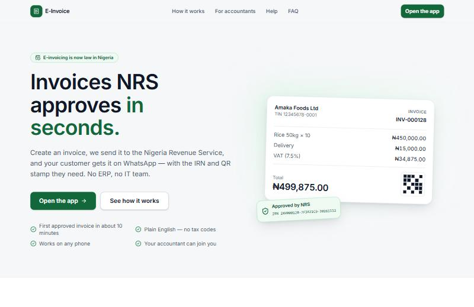
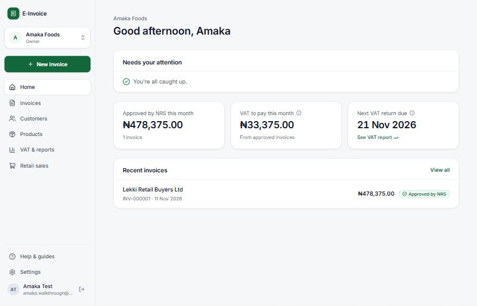
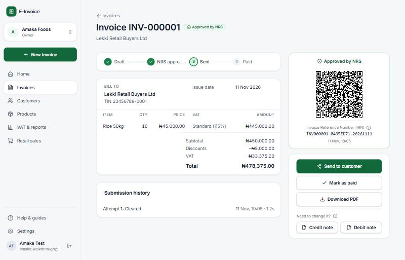
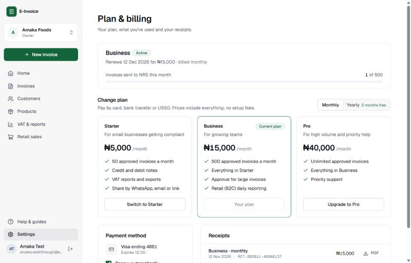
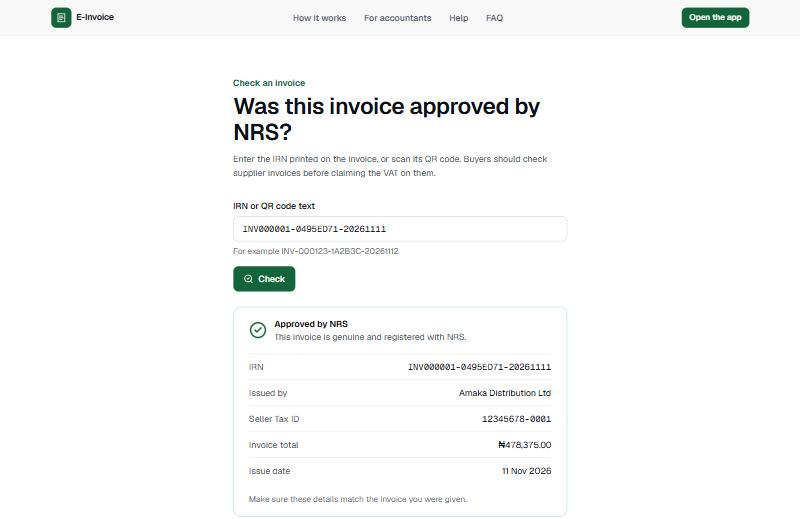
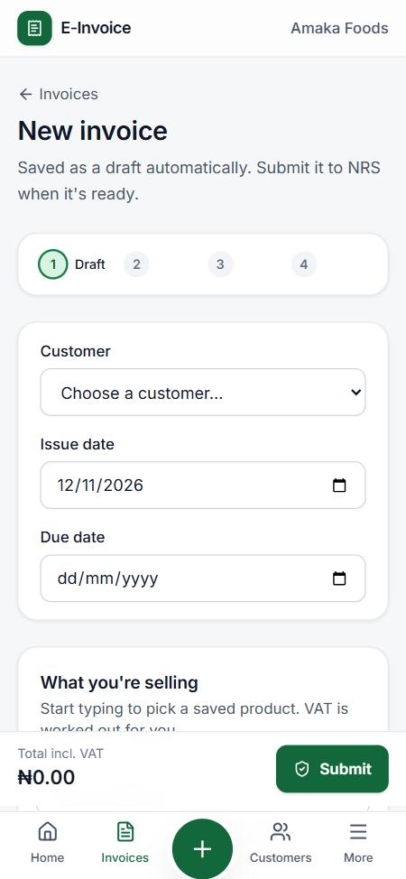
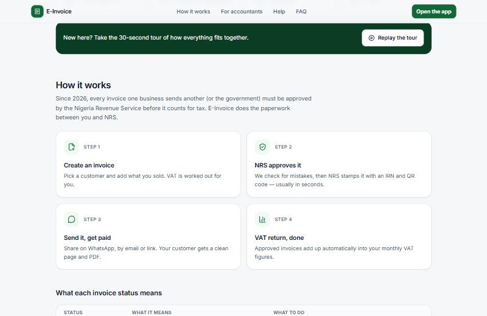

# E-Invoice

**Invoices the Nigeria Revenue Service approves in seconds — for small businesses and their accountants.**

Create an invoice, E-Invoice sends it to NRS for approval, and your customer gets it on WhatsApp with the
Invoice Reference Number (IRN) and QR stamp they need. No ERP, no IT team, no tax jargon.



---

## Why this exists

Nigeria is moving to **mandatory e-invoicing**. Every invoice one business sends another (or the government)
must be checked and approved — "cleared" — by the Nigeria Revenue Service (NRS) through its
**Merchant Buyer Solution (MBS)** before it counts for tax. Large buyers already refuse invoices without an IRN,
because they need it to claim back the VAT they paid.

Big companies connect their ERP systems to MBS. Small and medium businesses — and the accountants who look
after them — mostly invoice from Word or Excel, and businesses with turnover under ₦1bn are expected to be in
scope by **July 2027**. E-Invoice is the simple way for them to comply.

## What you can do with it

| If you are… | E-Invoice lets you… |
|---|---|
| **A business owner** | Issue NRS-approved invoices in minutes, share them on WhatsApp or email, see who owes you, and know what VAT you owe this month |
| **Finance staff** | Save customers and products once, fix rejected invoices with clear instructions, upload a day's till sales in one go |
| **An accountant** | Manage every client from one login, see who needs attention on one dashboard, and produce VAT figures that match the return |
| **A buyer** | Open a clean invoice page from a link, check the NRS stamp, and download the PDF |

## How it works

1. **Create an invoice** — pick a customer, add what you sold. VAT (7.5%, zero-rated or exempt) is worked out for you, and drafts save as you type.
2. **NRS approves it** — we check for common mistakes first, then send it. NRS returns an IRN and QR stamp, usually in seconds. If NRS is down, it waits safely and retries for up to 72 hours.
3. **Send it, get paid** — share by WhatsApp, email or link. Mark it paid when the money arrives.
4. **Your VAT return, done** — approved invoices, credit/debit notes and daily retail sales add up into your monthly VAT figures, exportable to Excel or PDF.



### What each status means

| Status | Meaning | What to do |
|---|---|---|
| Draft | Saved, not sent yet | Finish it and press **Submit to NRS** |
| Needs approval | Waiting for an owner or approver | Approvers open it and approve |
| Sending to NRS / Waiting for NRS | With NRS, or queued while NRS is unavailable | Nothing — it's automatic |
| **Approved by NRS** | Has an IRN and QR stamp; locked | Send it to your customer |
| Needs fixing | NRS found a problem | Open it — the fix is explained next to the field |



## Features

**Getting started**
- Sign in with a one-time code (email or SMS) — no passwords; optional two-step verification
- Tax ID checked against NRS with the registered name pre-filled; your e-invoicing deadline shown
- One-click connection to NRS (link → practice invoice → go live)
- Logo, bank details and terms on every invoice

**Invoicing**
- Customers with Tax ID checks and duplicate warnings; products with their VAT treatment
- Import customers and products from CSV or Excel, with a row-by-row check first
- Live totals, autosave, and a pre-submission check in plain English
- Credit notes and debit notes linked to the original IRN (approved invoices are never edited)
- Share by WhatsApp, email or link; buyers get a mobile page and PDF
- Approvals: clerks prepare, owners or approvers release; invoices above an amount you set need a second person
- Check any supplier invoice at `/verify` by typing its IRN or scanning its QR code

**Retail (B2C) sales**
- Upload the day's till export; amounts can include VAT, dates can be day-first
- Each day is reported to NRS automatically after midnight; "No sales" for quiet days
- Email and SMS alerts 6 hours before a day's deadline

**VAT & reports**
- Monthly VAT reconciliation against the figure you filed, with everything not yet included listed
- Excel and PDF exports that always match the screen
- Sales by month, money owed to you, overdue invoices

**Accounting firms**
- One login for all clients; dashboard sorted by what needs attention
- Clients link with an 8-character firm code and can remove access any time
- Monthly firm bill per client

**Plans and billing**
- 14-day free trial with up to 20 approved invoices, no card needed
- Starter ₦5,000 / Business ₦15,000 / Pro ₦40,000 a month (yearly = 10 months), paid by card, bank transfer or USSD
- Usage meter with a warning at 80%; upgrades credit unused days, downgrades wait for renewal
- Card renewals retried daily for 7 days before sending pauses; drafts and approved invoices always stay available
- PDF receipts, emailed and downloadable





**Help built in**
- ⓘ and underlined terms explain tax words where you meet them
- A short, skippable welcome tour; a Help centre with guides, glossary and FAQ

<p align="center"></p>

## Key terms

| Term | Meaning |
|---|---|
| **NRS** | Nigeria Revenue Service (formerly FIRS) |
| **MBS** | NRS's Merchant Buyer Solution — the system that approves invoices |
| **Clearance** | NRS checking and approving an invoice |
| **IRN** | Invoice Reference Number — NRS's unique stamp on an approved invoice |
| **TIN** | Tax Identification Number, e.g. `12345678-0001` |
| **B2B / B2G / B2C** | Selling to businesses / government / consumers |
| **Output VAT** | VAT you charged customers; what you pay on your monthly return (due the 21st) |
| **Credit / debit note** | A document that reduces / increases an approved invoice |

More in the in-app [Help centre](apps/web/src/app/help/page.tsx) and [glossary](apps/web/src/lib/glossary.ts).



## Status and roadmap

| Phase | Scope | Status |
|---|---|---|
| 0–1 | Foundation, sign-in, onboarding, customers/products, invoices, NRS clearance, sharing, notes, roles, audit log | ✅ Built |
| 2 | VAT reconciliation and exports, retail (B2C) daily reporting, accounting firm workspace | ✅ Built |
| UX | Design system refresh, simplified navigation, explainers, welcome tour, Help centre, landing page | ✅ Built |
| 3 | Plans and billing in naira (Paystack), approval above an amount, supplier IRN check | ✅ Built |
| 4 | Live NRS Access Point integration and certification, WhatsApp Business API, load and penetration testing | Before launch |

> **Note:** NRS/MBS, the Tax ID registry, SMS, WhatsApp and (until you add a Paystack key) payments
> currently run against **mock/sandbox implementations** behind clean interfaces. Going live requires an accredited Access Point Provider (Phase 4).

## How it's built

| | |
|---|---|
| Web | Next.js 15 (App Router), Tailwind CSS 4, Radix UI, TanStack Query — mobile-first, WCAG 2.1 AA |
| API | NestJS 11, Prisma 6, zod-validated requests, RFC 9457 errors in plain English |
| Data | PostgreSQL (Supabase) with row-level security for tenant isolation; cleared invoices locked by database triggers |
| Hosting | Vercel (web + API) and Supabase; background jobs via a Postgres job queue triggered every minute |
| Quality | 57 automated tests (unit + end-to-end against real Postgres), CI with CodeQL and secret scanning |

Read more: [architecture](docs/architecture.md) · [security](docs/security.md) · [UX principles](docs/ux-principles.md)

## Run it locally

Requirements: Node 20+, pnpm 10, and a PostgreSQL database (Supabase or local).

```bash
pnpm install
cp apps/api/.env.example apps/api/.env   # then set SUPABASE_DB_URL (or ADMIN_DATABASE_URL)
pnpm --filter @einv/shared build
pnpm --filter @einv/api db:setup         # migrations, runtime role, secrets
pnpm dev                                 # web on :3000, API on :4000
```

In development the sign-in code is shown on screen. Try Tax ID `12345678-0001` to see the name-mismatch warning.

```bash
pnpm test        # all tests (end-to-end tests need the database configured)
```

## Repository layout

```
apps/web          Next.js web app (landing page, app, help centre)
apps/api          NestJS API, Prisma schema and migrations, tests
packages/shared   VAT maths, schemas, roles and status rules shared by web and API
docs/             Architecture, security, UX principles, screenshots
```

## License

[Apache 2.0](LICENSE)
